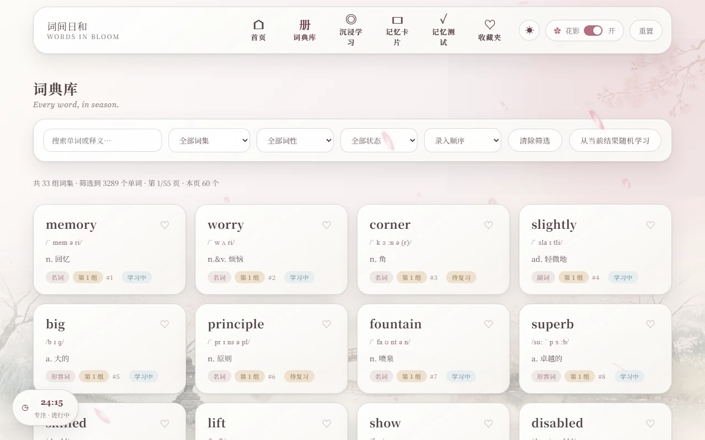
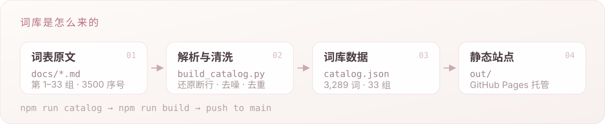

<p align="center">
  
</p>

<p align="center">
  <b><a href="https://cheshiping.github.io/words-to-bachelor-s/">cheshiping.github.io/words-to-bachelor-s</a></b>
</p>

<p align="center">
  <a href="https://cheshiping.github.io/words-to-bachelor-s/"></a>
  
  
  
  
</p>

<p align="center">
  把《2027 专升本 3500 词》与《专升本真题核心词组》做成一间可以一直待下去的网页书房。<br>
  打开先选词书，浏览器自动记住；无需登录，学习进度只写在你自己的浏览器里。
</p>

---

## 界面

<p align="center">
  
  
</p>
<p align="center">
  
  
</p>

<p align="center"><sub>浅色「暖粉和风」与暗色「夜樱」，同一张卡片，两种光。</sub></p>

## 能做什么

- **双词书** —— 首次打开先选一本，浏览器自动记住；顶栏随时切换，每本书的进度、收藏与复习排期各自独立保留。
- **词典库** —— 3500 词书 3,289 词 / 33 组词集；真题词组书 764 条 / 39 页，按标签分类筛选；支持搜索、排序与分页。
- **沉浸学习** —— 一次只面对一个词：大字、音标、释义（词组书另配英文例句与中文译文），配 `学习 / 待复习 / 已掌握` 三档状态。
- **记忆卡片** —— 点击翻面，左右滑动换卡；可单独按词集或状态抽卡，待复习的词可一键标为「已掌握」。
- **记忆测试** —— 看释义选单词、看单词选释义、拼写填空三种题型混合出题（词组书只出中英互测），答完给错题清单。
- **间隔复习** —— 答对累积、答错清零并重新排期，复习时间从 4 小时递增到 30 天。
- **移动端手势** —— 左右滑动切换单词、卡片乃至整个页面，底部导航常驻，触屏目标均不小于 44px。
- **明暗双主题** —— 夜樱模式默认跟随系统偏好，也可在顶栏手动切换并记住选择。
- **进度自持** —— 状态、收藏、连续天数、测试成绩全部存在 `localStorage`，无账号、无后端、不上传。

## 词库是怎么来的

<p align="center">
  
</p>

词表原文是 PDF 转出来的文本，直接拿来用会踩到一堆坑。`scripts/build_catalog.py` 逐条处理：

- 还原被换行截断的音标与释义 —— `misunderstand` 的音标、`announcement` 的「通知」都会接回去；
- 滤掉混在词条里的对话噪声（「好的，我们继续。这是第 20 组单词。」这类）；
- 修正被拆开的单词 —— `caf é → café`、`o ’ clock → o'clock`；
- 按原书编排划分难度——**基础词**（1–2200）、**进阶词**（2301–3000）、**高分词**（3101–3500）；
- 依据词性生成 `名词 / 动词 / 形容词 …` 分类，供词典库筛选；
- 全局去重（保留首次释义），并保留原书序号 —— 第 1493 号就是 `black`，和纸质书一一对得上。

> 原书 3500 个序号中，1492–1499 在原文里写作 `149 2`、`149 3`，2201–2300 与 3001–3100 则整段缺失，最终收录 3,289 个单词。

词组书由同一个脚本的 `parse_phrases()` 解析 `docs/专升本真题核心词组.md` 的 4 列表格：

- 按原书 **39 页**分节，764 条编号 1–764 逐条校验（列数、编号连续、例句必须是英文 + 中文两行）；
- 多义项的 `<br>` 合并成中文分号，避免把 HTML 带进界面；
- 从 `usage. / phrv. / idm. / collocation.` 等标签派生 7 类分类，供词典库筛选；
- 例句拆成 `exampleEn / exampleZh` 两个字段；Word 列里的 `(sb)`、`…` 原样保留，这是真题原形态。

三份数据（3500 词书、词组书、词书清单）都由 `npm run catalog` 确定性生成，`init.sh` 会重新生成后逐文件 diff 做幂等校验。前端只先取几 KB 的清单，再按用户选择拉取对应词书，加第三本书无需改前端代码。

## 快速开始

```bash
npm install
npm run dev      # http://localhost:3000
```

构建与本地预览：

```bash
npm run build    # 静态产物输出到 out/
npm run start    # 用 npx serve 预览 out/
```

重新生成全部词书（需 Python 3）：

```bash
npm run catalog                      # = python scripts/build_books.py
node scripts/check_migration.mjs     # 改动进度存储后跑一次回归（6 组断言）
```

`scripts/build_books.py` 输出三份文件，生成结果确定性可复现：

```text
public/data/catalog.json                3500 词书（3,289 词）
public/data/books/phrases-764.json      真题核心词组（764 条）
public/data/books/index.json            词书清单（元信息 + 能力开关 + dataUrl）
```

新增词书只需在这个脚本里加一个解析函数、一个 JSON 与一条清单记录，前端完全由清单驱动，无需改动。

## 部署

推送到 `main` 即自动发布 —— 工作流在 `.github/workflows/deploy.yml`：

1. 首次使用时，在仓库 **Settings → Pages → Source** 选择 **GitHub Actions**（只需设置一次）；
2. 之后每次推送 `main`，都会自动构建并发布到 <https://cheshiping.github.io/words-to-bachelor-s/>。

工作流会自动判定部署路径：项目页设置 `NEXT_PUBLIC_BASE_PATH=/<仓库名>`，用户页留空；并生成 `out/.nojekyll`，避免 Jekyll 吞掉 `_next/` 目录。

本地复现线上效果（注意子路径构建产物只能在子路径下访问）：

```powershell
$env:NEXT_PUBLIC_BASE_PATH = "/words-to-bachelor-s"
npm run build
```

## 项目结构

```text
app/                 页面与全局样式（App Router）
components/          BloomApp.jsx（应用主体）、userStorage.mjs（进度分桶与 v2→v3 迁移）
public/data/         catalog.json（3500 词书）+ books/（词组书 JSON 与 index.json 清单）
docs/                两份词表原文 Markdown
scripts/             build_books.py（多词书管线）、check_migration.mjs（存储回归）
assets/readme/       README 配图（SVG + WebP）
out/                 npm run build 的静态产物
```

## 技术栈

Next.js 15（`output: "export"` 静态导出） · React 19 · GSAP 页面编排与指针动效 · WAAPI 卡片切换 · 纯 CSS 设计系统（暖粉和风 + 液态玻璃 + 三层花瓣粒子） · 无后端、无数据库、无追踪。
